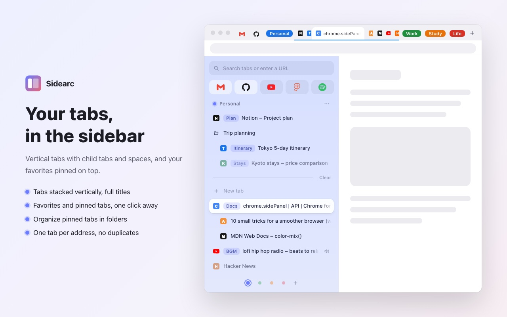

# Sidearc

[简体中文](README.md) | English | [Website and live demo](https://winzipsdo.github.io/sidearc/en/)

[](https://github.com/winzipsdo/sidearc/releases/latest)   [](LICENSE)

**Arc-style vertical tabs for Chrome.** Tabs stacked in the side panel, split into spaces, and kept in two-way sync with Chrome's own tab strip. Plain JS/CSS, no network requests, your data stays local.



### Not a second list. The same one.

Chrome's tab strip follows the sidebar: drag on either side and the other one moves with it.


| Spaces are tab groups up top | Fallen leaves flag what to close |
| --- | --- |
|  |  |
| Work, study, life: each gets its own tabs and color. Switch from the tab strip or the dots. | Leave a tab for a day and leaves start to fall. Sweep them off, or open it and they blow away. |

**[→ Try it live, no install](https://winzipsdo.github.io/sidearc/en/#try)**: the demo runs the extension's actual code.

## Features

**Organize**

- **Spaces**: a set of tabs, pinned tabs and a color for each, shown as one tab group up top.
- **Child tabs**: tabs land under the page you opened them from; drop one on another to nest it.
- **Pinned tabs**: keep their spot when closed; wander off and ↩ takes you home; folders and folding included.
- **Favorites**: a row of icons up top, shared by every space.
- **Aliases**: give a tab a short name that search understands.

**Find your way back**

- **Footprints**: the last few tabs you left keep a fading mark, so you can turn right back.
- **Fallen leaves**: tabs you haven't opened in a while gather leaves, so you see what to close.
- **Search**: press `/` to search tabs and the last 30 days of history at once; Enter opens a URL.
- **Keyboard**: arrow keys move a Switch-style cursor; Enter opens, Delete closes.

**Stay out of the way**

- **One tab per address**: open something that's already open and you jump to it.
- **Undo everything**: closed the wrong thing? `Ctrl/⌘+Z`, step by step, even from the tab strip.
- **Sleep**: unload a tab from memory in one click; keep music or chat awake.
- **Multi-select**: `Ctrl/⌘` or `Shift`-click a batch and drag, close or move them together.
- **No history**: turn it on for a space or folder and its visits vanish from history.

Plus: closing a tab takes you back to where you were, recently closed tabs, hard reload, light and dark, English and Chinese.

The full behavior of every feature is in **[Features in detail](docs/features.en.md)**; keyboard shortcuts are under [Shortcuts](#shortcuts).

## Install

1. Download the latest `sidearc-<version>.zip` from [Releases](https://github.com/winzipsdo/sidearc/releases/latest) and unzip it — or clone this repository to follow the latest code.
2. Open `chrome://extensions`, turn on Developer mode (top right), click "Load unpacked" and choose the unzipped folder (or the repository folder).
3. Click the toolbar icon, or press `Alt+S` (`⌥ Option+S` on Mac), to toggle the sidebar.

Requires Chrome 116 or later.

**Sidebar on the left**: Chrome shows side panels on the right by default. To put it on the left like Arc, open `chrome://settings/appearance` and set the side panel position to left.

## Shortcuts

| Action | Windows / Linux | Mac |
| --- | --- | --- |
| Toggle the sidebar | `Alt+S` | `⌥ Option+S` |
| Undo (sidebar focused) | `Ctrl+Z` | `⌘+Z` |
| Open search | `/` or `Ctrl+F` | `/` or `⌘+F` |
| Search box: skip matches, open the URL or search | `Ctrl+Enter` | `⌘+Enter` |
| Search box: clear and close | `Esc` | `Esc` |
| Keyboard cursor: move (starts from the current page; ↓ in the search box starts from the top) | `↑` `↓` `←` `→` | `↑` `↓` `←` `→` |
| Keyboard cursor: open / close / context menu | `Enter` / `Delete` / `Shift+F10` | `Enter` / `Delete` / `Shift+F10` |
| Keyboard cursor: expand / collapse a folder | `→` / `←` | `→` / `←` |
| Close a tab | Middle-click or ✕ | Middle-click or ✕ |
| Reopen the last closed tab (Chrome's own) | `Ctrl+Shift+T` | `⌘+Shift+T` |

After Enter opens a tab, Chrome moves keyboard focus into that page; press `F6` (maybe a few times) to bring focus back to the sidebar.

The sidebar shortcut can be changed at `chrome://extensions/shortcuts`.

## Permissions and privacy

Sidearc collects and uploads nothing; the code makes no network requests. Spaces, favorites, pinned tabs and aliases are stored locally and removed when you uninstall. See the [privacy policy](PRIVACY.md).

| Permission | Used for |
| --- | --- |
| `sidePanel` | The whole interface lives in the side panel. |
| `tabs` | Listing tabs (title, URL, icon) and switching, moving, closing and opening them. |
| `storage` | Saving spaces, favorites, pinned tabs, aliases and tab state for restoring after a restart. |
| `favicon` | Showing site icons for favorites and pinned tabs. |
| `search` | Searching with your default engine from the search box. |
| `clipboardWrite` | "Copy link address". The clipboard is never read. |
| `sessions` | Restoring closed tabs on undo. |
| `history` | Listing matching pages from the last 30 days when you search, deleting one with ×, and removing the pages just visited from no-history spaces and folders. Read locally, never sent anywhere. |
| `webNavigation` | Telling whether a new tab was opened from a link on a page (child tabs) and whether its address is already open (no duplicate tabs). |
| `tabGroups` | Showing each space as a tab group in Chrome's tab strip and collapsing the other spaces. |

## Known limitations

- Sidearc manages the order of its space groups in Chrome's tab strip. Tab groups created by you or by other extensions (such as Claude) are left alone — they're kept intact and placed after the space groups. Chrome's natively pinned tabs stay on the far left. Tab groups support only 9 colors, so each space uses the closest one.
- Spaces, child tabs, aliases and pins are matched back to tabs by URL and position after a restart, which relies on Chrome restoring your previous tabs on startup ("Continue where you left off"). With another startup setting, the sidebar offers to restore last time's tabs at the top (and under Recently closed until the next restart), back in their spaces with child tabs and aliases, unloaded until opened.
- "No duplicate tabs" can only decide once the new tab's address is known, so a duplicate may flash briefly before closing.
- Newer Chrome versions may save tab groups automatically and sync them to your other devices, so space groups can show up there too.
- No-history removes pages by URL: history left by the same URL from other spaces disappears too, while recently closed tabs still list it.

## Development

No build step: the code is plain ES modules — edit, then reload the extension at `chrome://extensions`.

```bash
npm test
```

Tests use Node's built-in test runner (Node 20+), no dependencies. `npm run screenshots` regenerates the store screenshots and promo tiles in Chinese and English (needs Chrome installed).

See [CHANGELOG.md](CHANGELOG.md) for changes.

## Releasing

Releases are automated: when `version` in `manifest.json` changes on `main`, a GitHub Actions workflow runs the tests, builds the zip, tags `v<version>` and publishes a GitHub Release with notes picked from `CHANGELOG.md`. Sidearc isn't on the Chrome Web Store yet while it's still being polished; listing materials are ready in `store/listing.md`. Preview the notes locally with `npm run release-notes`.

## Website

<https://winzipsdo.github.io/sidearc/> is published from the `gh-pages` branch, which also keeps the site and intro-video sources under `source/` (see its `source/README.md`).

## Support

Sidearc is free and open source. If it's useful to you, consider [sponsoring on GitHub](https://github.com/sponsors/winzipsdo) — also reachable from "Support Sidearc" in the sidebar's settings menu.

## License

[MIT](LICENSE)
