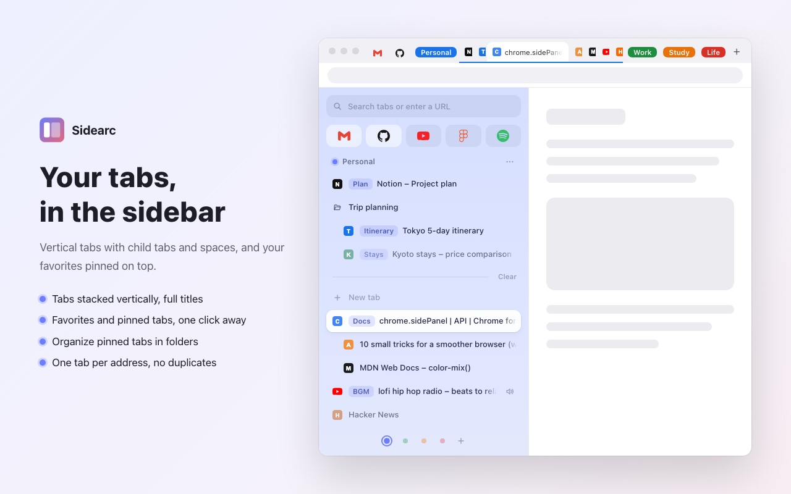
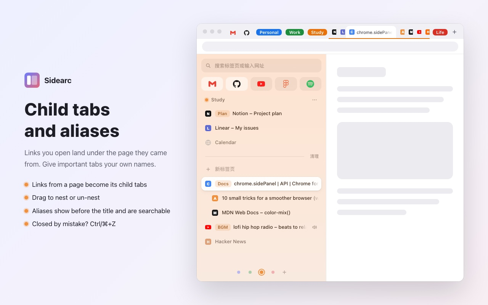
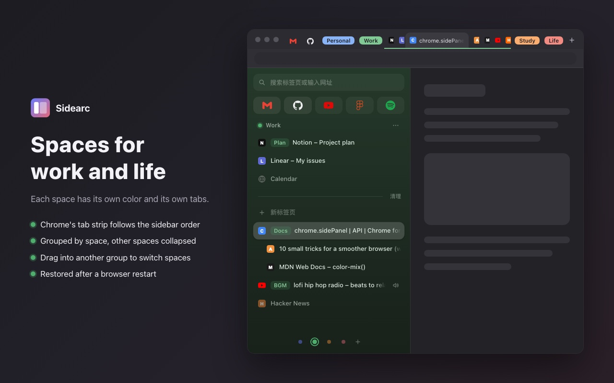

# Sidearc

[简体中文](README.md) | English

An Arc-style vertical tabs sidebar for Chrome: child tabs, spaces, pinned tabs and favorites, kept in sync with Chrome's own tab strip.

Built on Manifest V3 and `chrome.sidePanel` with plain JS/CSS — no build step, no dependencies, no network requests. All data stays on your machine.

> The interface is currently in Simplified Chinese.



| Child tabs and aliases | Spaces and dark mode |
| --- | --- |
|  |  |

## Features

See [Shortcuts](#shortcuts) for keyboard shortcuts.

### Tabs

- **Vertical tabs**: click to switch, middle-click or ✕ to close, drag to reorder. Tabs playing sound show a speaker you can click to mute — favorites and pinned tabs too.
- **Synced with Chrome's tab strip**: the order of Chrome's native tab strip always matches the sidebar — open favorites on the far left, then one tab group per space; inside each group, pinned tabs first, then the list, with child tabs right after their parent.
  - Drag in the sidebar and the tab strip follows; drag in the tab strip and the sidebar follows.
  - Dragging a tab into another space's group in the tab strip moves it to that space; dragging a child tab away from its parent un-nests it.
- **Child tabs**: links you open from a page are indented under the page they came from.
  - Nest manually by dragging a tab onto another tab; drag it elsewhere, or right-click, to un-nest.
  - Two levels at most; closing a parent closes its children.
  - Links opened from other apps and brand-new tabs are not nested.
- **Aliases**: give a tab or pinned item your own short name, shown before the title and matched by search.
- **No duplicate tabs**: opening an address that is already open in the current space switches to the existing tab instead. Opening the address of a favorite or pinned tab that isn't open yet opens it as that favorite or pinned tab. Tabs you deliberately open in a new tab (`Ctrl/⌘+click`, middle-click) are left alone.
- **Search box**: type to filter; Enter jumps to the first match, or opens the URL / searches with your default engine.
- **Close in bulk**: "Clear" closes every unpinned tab in the current space except the active one; right-click a tab to close all tabs below it.

### Favorites, pinned tabs and spaces

- **Favorites**: an icon grid at the top, shared by all spaces. Drag a tab in to add it.
- **Pinned tabs**: one set per space. Closing the tab keeps the pinned item; click it to reopen. Hover to close the tab but keep the pin (−), or to unpin a closed one.
  - When an open pinned tab navigates elsewhere, the row shows the current page; ↩ takes it back to the pinned address.
  - **Folders**: group pinned tabs into folders; drag items in and out, collapse and expand, rename.
- **Spaces**: switch with the dots at the bottom. Each space has its own color, pinned tabs and tabs. In Chrome's tab strip each space is a tab group — the current one expanded, the others collapsed; expand one to switch to it.
- **No-history spaces and folders**: pages visited from them are removed from browser history right away. This is not incognito mode: cookies, logins and cache are kept.

### Also

- **Undo**: closing tabs, Clear, unpinning and more can be undone from the toast or with `Ctrl/⌘+Z`, step by step. Tabs closed from Chrome's own tab strip can be restored the same way.
- **Recently closed**: the clock button at the bottom left lists the last 10 closed tabs; click one to restore it (with its back/forward history) into the current space. The bottom of the list opens Chrome's full history. It uses Chrome's own list, so it covers this browser session only and isn't split by space.
- **Context menus** on tabs, favorites, pinned items and space dots.
- **Light and dark mode**, following the system.

## Install

1. Open `chrome://extensions` and turn on Developer mode (top right).
2. Click "Load unpacked" and choose this repository's folder.
3. Click the toolbar icon, or press `Alt+S` (`⌥ Option+S` on Mac), to toggle the sidebar.

Requires Chrome 116 or later.

**Sidebar on the left**: Chrome shows side panels on the right by default. To put it on the left like Arc, open `chrome://settings/appearance` and set the side panel position to left.

## Shortcuts

| Action | Windows / Linux | Mac |
| --- | --- | --- |
| Toggle the sidebar | `Alt+S` | `⌥ Option+S` |
| Undo (sidebar focused) | `Ctrl+Z` | `⌘+Z` |
| Search box: skip matches, open the URL or search | `Ctrl+Enter` | `⌘+Enter` |
| Search box: clear | `Esc` | `Esc` |
| Close a tab | Middle-click or ✕ | Middle-click or ✕ |

The sidebar shortcut can be changed at `chrome://extensions/shortcuts`.

## Permissions and privacy

Sidearc collects and uploads nothing; the code makes no network requests. Spaces, favorites, pinned tabs and aliases are stored locally and removed when you uninstall. See the [privacy policy](PRIVACY.md).

| Permission | Used for |
| --- | --- |
| `sidePanel` | The whole interface lives in the side panel. |
| `tabs` | Listing tabs (title, URL, icon) and switching, moving, closing and opening them. |
| `storage` | Saving spaces, favorites, pinned tabs, aliases and tab state for restoring after a restart. |
| `favicon` | Showing site icons for favorites and pinned tabs. |
| `search` | Searching with your default engine from the search box. |
| `clipboardWrite` | "Copy link address". The clipboard is never read. |
| `sessions` | Restoring closed tabs on undo. |
| `history` | Only for no-history spaces and folders: deleting the pages just visited from them. |
| `webNavigation` | Telling whether a new tab was opened from a link on a page (child tabs) and whether its address is already open (no duplicate tabs). |
| `tabGroups` | Showing each space as a tab group in Chrome's tab strip and collapsing the other spaces. |

## Known limitations

- Sidearc manages the order and groups of Chrome's tab strip: tab groups you created yourself are reorganized into space groups. Chrome's natively pinned tabs are left alone on the far left. Tab groups support only 9 colors, so each space uses the closest one.
- Spaces, child tabs, aliases and pins are matched back to tabs by URL and position after a restart, so Chrome has to restore your previous tabs on startup.
- "No duplicate tabs" can only decide once the new tab's address is known, so a duplicate may flash briefly before closing.

## Development

No build step: the code is plain ES modules — edit, then reload the extension at `chrome://extensions`.

```bash
npm test
```

Tests use Node's built-in test runner (Node 20+), no dependencies. `npm run screenshots` regenerates the store screenshots and promo tiles in Chinese and English (needs Chrome installed).

See [CHANGELOG.md](CHANGELOG.md) for changes.

## License

[MIT](LICENSE)
