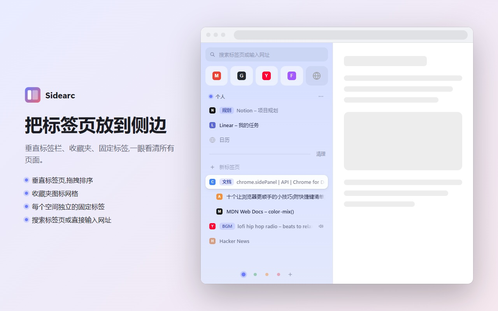
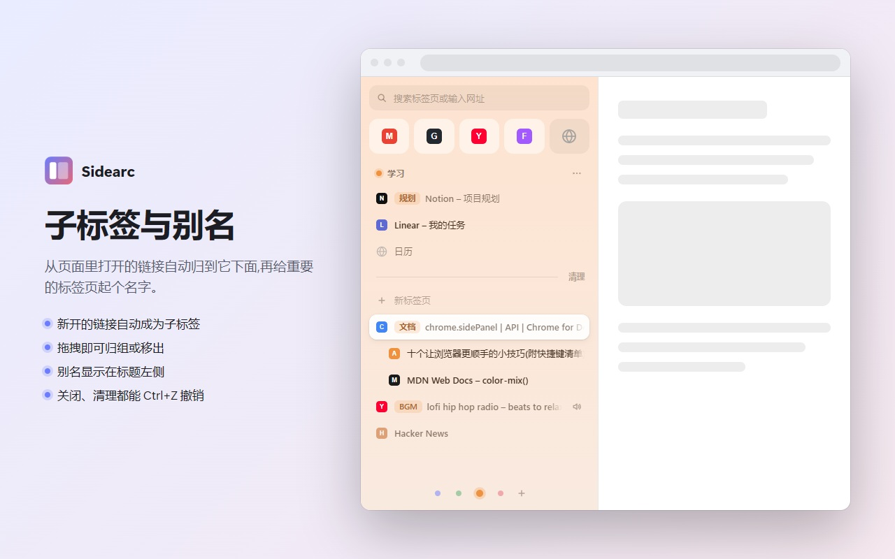
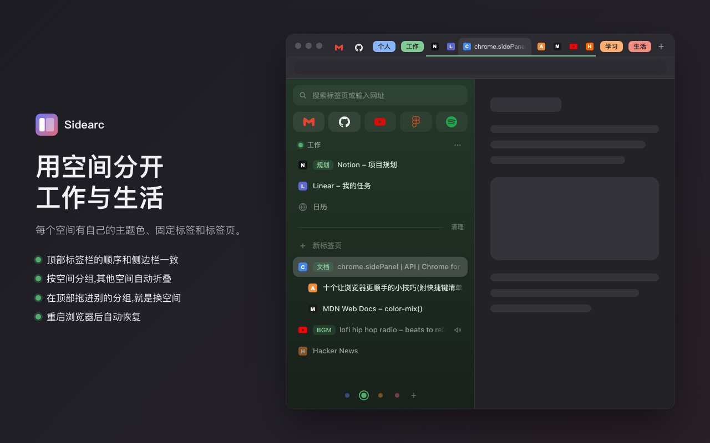

# Sidearc

把标签页放到侧边栏:垂直排列,支持子标签和空间,常用的固定在顶部。

Arc 风格的 Chrome 侧边标签栏。基于 Manifest V3 和 `chrome.sidePanel`,纯原生 JS/CSS,无构建步骤、无依赖;不联网,数据只存在本机。



| 子标签与别名 | 空间与深色模式 |
| --- | --- |
|  |  |

## 功能

快捷键见下文的[快捷键与操作](#快捷键与操作)。

### 标签页

- **垂直标签栏**:点击切换,中键或 ✕ 关闭,拖拽排序,正在发声的标签可一键静音。
- **子标签**:在网页里点链接开出的新标签页,会自动缩进显示在原标签页下面。
  - 也可以手动归组:把标签页拖到另一个标签页上。
  - 移出:拖到别处,或右键「移出为顶级标签页」;右键父标签选「解除所有子标签」可一次全部移出。
  - 最多两级,从子标签里打开的会和它并列;关闭父标签页会连同子标签一起关闭。
  - 从其他应用(比如聊天软件)点开的链接、新建的标签页不算子标签。
- **别名**:双击标签行或右键设置,显示在标题左侧,搜索也会匹配。
- **相同地址只开一份**:新开的标签页如果和本窗口同一个空间里已有的标签页地址相同(忽略 `#` 锚点),会直接切到已有的那个并关掉新开的;如果地址和某个还没打开的收藏或本空间的固定标签相同,新开的标签页会直接成为它的标签页,显示在收藏夹或固定标签里。Chrome 自带的「复制标签页」和恢复关闭的标签页不受影响。
- **搜索栏**:输入即过滤;回车跳到第一个匹配项,没有匹配时打开网址或用默认搜索引擎搜索。
- **批量关闭**:「清理」一键关闭当前空间里除当前页以外的未固定标签页;右键标签页可「关闭下方所有标签页」。

### 收藏夹、固定标签与空间

- **收藏夹**:顶部的图标网格,所有空间共用。把标签页拖进去即可添加。
- **固定标签**:每个空间一组。关闭标签页后固定项仍保留,再点会重新打开。鼠标移上去时,右侧有一个按钮:标签页开着时是「−」,只关闭标签页、保留固定;没开着时是带斜线的图钉,点了取消固定(可撤销)。
- **空间**:底部圆点切换,每个空间有自己的主题色、固定标签和标签页。把标签页拖到圆点上可移到别的空间。
- **不记录历史的空间**:右键空间圆点开启后,在该空间里访问的网址会立刻从浏览历史中删除。这不是无痕模式:Cookie、登录状态、缓存和下载记录照常保留。

### 其他

- **撤销**:关闭标签页、清理、关闭下方所有标签页、取消固定、从收藏夹移除、相同地址的自动切换、从 Arc 导入,都可以点底部提示条的「撤销」或按快捷键撤销,可连续撤销多步。在 Chrome 自己的标签栏里关掉的标签页,在侧边栏里按快捷键也能恢复,和其他操作按先后顺序一起撤销。
- **从 Arc 导入**:空间菜单里选「从 Arc 导入…」,选择 Arc 的 `StorableSidebar.json`,即可导入收藏夹、各空间的固定标签和打开的标签页。该文件在 macOS 上位于 `~/Library/Application Support/Arc/`,在 Windows 上位于 `%LOCALAPPDATA%\Packages\TheBrowserCompany.Arc_*\LocalCache\Local\Arc\`。
- **右键菜单**:标签页、收藏/固定项、空间圆点都有,可以复制链接地址、移到别的空间等。
- **浅色 / 深色模式**:跟随系统。

## 安装

1. 打开 `chrome://extensions`,开启右上角的「开发者模式」。
2. 点「加载已解压的扩展程序」,选择本仓库所在文件夹。
3. 点工具栏上的插件图标,或按 `Alt+S`(Mac 上是 `⌥ Option+S`)打开/关闭侧边栏。

需要 Chrome 116 或更高版本。

### 把侧边栏放到左边

Chrome 的侧边栏默认在右侧。想让它像 Arc 一样在左边,打开 `chrome://settings/appearance`(设置 → 外观),把「侧边栏位置」改为「显示在左侧」。这是 Chrome 自己的设置,对所有侧边栏生效,扩展无法代为修改。

## 快捷键与操作

| 操作 | Windows / Linux | Mac |
| --- | --- | --- |
| 打开 / 关闭侧边栏 | `Alt+S` | `⌥ Option+S` |
| 撤销(焦点在侧边栏时) | `Ctrl+Z` | `⌘+Z` |
| 搜索栏:跳过匹配项,直接打开网址或搜索 | `Ctrl+回车` | `⌘+回车` |
| 搜索栏:清空 | `Esc` | `Esc` |
| 右键菜单 | 鼠标右键 | 鼠标右键、`Control+点按` 或触控板双指点按 |
| 关闭标签页 | 鼠标中键或 ✕ | 鼠标中键或 ✕(触控板没有中键,用 ✕) |
| 重新打开刚关闭的标签页(Chrome 自带) | `Ctrl+Shift+T` | `⌘+Shift+T` |

打开侧边栏的快捷键可以在 `chrome://extensions/shortcuts` 里修改;如果它和别的扩展或系统快捷键冲突,Chrome 可能不会自动分配,需要在那里手动设置。

## 权限与隐私

Sidearc 不收集、不上传任何数据,代码里没有网络请求。空间、收藏夹、固定标签、别名都保存在浏览器本地,卸载扩展即删除。完整说明见[隐私政策](PRIVACY.md)。

| 权限 | 用来做什么 |
| --- | --- |
| `sidePanel` | 全部界面都显示在浏览器侧边栏里。 |
| `tabs` | 读取标签页的标题、网址和图标来列出它们,并执行切换、移动、关闭、新建。 |
| `storage` | 在本地保存空间、收藏夹、固定标签、别名,以及重启后恢复用的标签页状态。 |
| `favicon` | 显示收藏夹和固定标签的网站图标。 |
| `search` | 在搜索栏输入关键词回车时,用浏览器的默认搜索引擎搜索。 |
| `clipboardWrite` | 「复制链接地址」时把网址写入剪贴板,不读取剪贴板。 |
| `sessions` | 撤销「关闭标签页」时,从最近关闭的记录里恢复它。 |
| `history` | 只用于「不记录历史」的空间:删除刚在该空间里访问的网址,不读取其他历史。 |
| `webNavigation` | 判断新标签页是不是从某个页面里的链接打开的(子标签),以及它载入的地址是否已经打开(相同地址只开一份)。 |

## 已知限制

- Chrome 不允许扩展隐藏顶部的原生标签栏,切换空间也只是过滤侧边栏里的列表。
- 标签页的空间归属、父子关系、别名和固定绑定,在浏览器重启或扩展重新加载后会按网址和位置重新对上。前提是 Chrome 启动时恢复了上次的标签页(设置 → 启动时 →「继续浏览上次打开的网页」);没有恢复出来的标签页,数据也就无从恢复。
- 「相同地址只开一份」要等新标签页的地址确定后才能判断,所以重复的标签页会先闪一下再关掉;只在同一个窗口、同一个空间内查重(收藏夹所有空间共用)。
- 「不记录历史」是按网址删除的:同一个网址在别的空间留下的历史也会一起消失;最近关闭的标签页里仍能找到。

## 文件

| 文件 | 作用 |
| --- | --- |
| `manifest.json` | 扩展清单 |
| `background.js` | 后台:点击图标开关侧边栏;子标签归属;相同地址查重;「不记录历史」;标签页关闭后的清理;重启后的数据恢复 |
| `sidepanel.html` / `.css` | 侧边栏的页面和样式 |
| `sidepanel.js` | 侧边栏入口,只做初始化 |
| `src/store.js` | 状态,以及读写状态的函数 |
| `src/render.js` | 把状态画到页面上 |
| `src/tabs.js` / `items.js` / `spaces.js` | 对标签页、收藏/固定项、空间的操作 |
| `src/menus.js` / `ui.js` | 右键菜单的内容;提示条、撤销、菜单外壳、对话框 |
| `src/drag.js` / `events.js` | 拖拽;事件绑定 |
| `src/arc.js` | 从 Arc 导入 |
| `src/dom.js` | 生成页面元素的小工具 |
| `src/logic.js` | 不碰浏览器的纯逻辑(网址判断、树形排列、拖拽落点、Arc 文件解析等) |
| `src/protocol.js` | 侧边栏和后台共用的约定:会话存储的键、消息格式 |
| `test/` | `src/logic.js` 和 `src/protocol.js` 的测试 |
| `icons/` | 扩展图标 |
| `store/` | Chrome 应用商店的上架资料、截图和宣传图 |
| `PRIVACY.md` | 隐私政策 |
| `CHANGELOG.md` | 更新日志 |

## 开发

没有构建步骤:代码是原生 ES 模块,改完在 `chrome://extensions` 里重新加载扩展即可。

测试用 Node 自带的测试运行器,不需要安装依赖(需要 Node 20 或更高版本):

```bash
npm test
```
