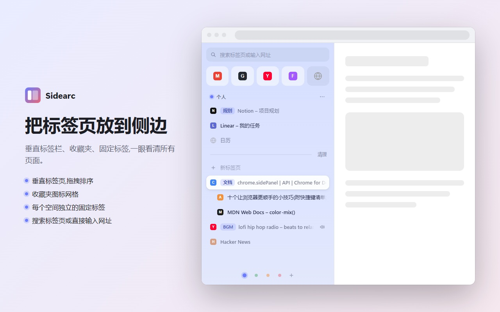

# Sidearc

简体中文 | [English](README.en.md) | [主页和在线试用](https://winzipsdo.github.io/sidearc/)

[](https://github.com/winzipsdo/sidearc/releases/latest)   [](LICENSE)

**Arc 风格的 Chrome 侧边标签栏。** 标签页竖着排、按空间分开,和 Chrome 顶部的标签栏双向同步。纯原生 JS/CSS,不联网,数据只在本机。



### 不是第二份列表,是同一份

Chrome 自己的标签栏跟着侧边栏走:在哪边拖,另一边都跟着动。


| 空间 = 顶部的一个分组 | 落叶:该关的会自己冒出来 |
| --- | --- |
|  |  |
| 工作、学习、生活各一套标签页和主题色,点顶部分组或底部圆点切换。 | 一天没进去,叶子就开始落;扫几下就干净,点开就吹走。 |

**[→ 不用安装,在线试一下](https://winzipsdo.github.io/sidearc/#try)**,跑的就是插件本身的代码。

## 功能

**整理**

- **空间**:每个空间一套标签页、固定标签和主题色,在顶部就是一个分组。
- **子标签**:从哪个页面点开的,就挂在哪下面;拖到别的标签页上就能归组。
- **固定标签**:关了也留着入口;跑到别的页面,点 ↩ 一键回家;能分文件夹、整组折叠。
- **收藏夹**:顶部一排图标,所有空间共用。
- **别名**:给标签页起个短名字,搜索也认。

**找回来**

- **足迹**:刚离开的几个标签页留一道慢慢消失的竖条,转身就找到。
- **落叶**:很久没进去的标签页落上叶子,一眼看出该关哪些。
- **搜索**:按 `/`,标签页和最近 30 天的历史记录一起搜;回车直接打开网址。
- **键盘**:方向键移动 Switch 风格的选中框,回车打开,Delete 关闭。

**不添乱**

- **只开一份**:已经开着的网址,不会再开第二个,直接切过去。
- **撤销一切**:关错了就 `Ctrl/⌘+Z`,一步步撤回,在顶部标签栏关的也行。
- **休眠**:一键把标签页从内存里卸掉;音乐、聊天可以保持唤醒。
- **多选**:`Ctrl/⌘`、`Shift` 点选一批,一起拖、一起关、一起换空间。
- **不记录历史**:给空间或文件夹打开,里面访问过的网址立刻从历史里抹掉。

还有:关掉当前标签页回到刚才那个、最近关闭、硬性重新加载、浅色 / 深色、中文 / English。

每个功能的完整行为见 **[功能详解](docs/features.md)**,快捷键见[快捷键与操作](#快捷键与操作)。

## 安装

1. 从 [Releases](https://github.com/winzipsdo/sidearc/releases/latest) 下载最新的 `sidearc-<版本号>.zip` 并解压。想跟着最新代码走,也可以直接克隆本仓库。
2. 打开 `chrome://extensions`,开启右上角的「开发者模式」,点「加载已解压的扩展程序」,选择解压出的文件夹(或仓库所在文件夹)。
3. 点工具栏上的插件图标,或按 `Alt+S`(Mac 上是 `⌥ Option+S`)打开/关闭侧边栏。

需要 Chrome 116 或更高版本。

### 把侧边栏放到左边

Chrome 的侧边栏默认在右侧。想让它像 Arc 一样在左边,打开 `chrome://settings/appearance`(设置 → 外观),把「侧边栏位置」改为「显示在左侧」。这是 Chrome 自己的设置,对所有侧边栏生效,扩展无法代为修改。

## 快捷键与操作

| 操作 | Windows / Linux | Mac |
| --- | --- | --- |
| 打开 / 关闭侧边栏 | `Alt+S` | `⌥ Option+S` |
| 撤销(焦点在侧边栏时) | `Ctrl+Z` | `⌘+Z` |
| 展开搜索 | `/` 或 `Ctrl+F` | `/` 或 `⌘+F` |
| 搜索栏:跳过匹配项,直接打开网址或搜索 | `Ctrl+回车` | `⌘+回车` |
| 搜索栏:清空并收起 | `Esc` | `Esc` |
| 键盘选择:移动(从当前页面开始;在搜索栏里按 ↓ 从第一项开始) | `↑` `↓` `←` `→` | `↑` `↓` `←` `→` |
| 键盘选择:打开 / 关闭 / 右键菜单 | `Enter` / `Delete` / `Shift+F10` | `Enter` / `Delete` / `Shift+F10` |
| 键盘选择:文件夹展开 / 收起 | `→` / `←` | `→` / `←` |
| 右键菜单 | 鼠标右键 | 鼠标右键、`Control+点按` 或触控板双指点按 |
| 关闭标签页 | 鼠标中键或 ✕ | 鼠标中键或 ✕(触控板没有中键,用 ✕) |
| 重新打开刚关闭的标签页(Chrome 自带) | `Ctrl+Shift+T` | `⌘+Shift+T` |

回车打开标签页后,Chrome 会把键盘焦点交给那个网页;要接着在侧边栏里选,按 `F6` 把焦点切回侧边栏(可能要按几次)。

打开侧边栏的快捷键可以在 `chrome://extensions/shortcuts` 里修改;如果它和别的扩展或系统快捷键冲突,Chrome 可能不会自动分配,需要在那里手动设置。

## 权限与隐私

Sidearc 不收集、不上传任何数据,代码里没有网络请求。空间、收藏夹、固定标签、别名都保存在浏览器本地,卸载扩展即删除。完整说明见[隐私政策](PRIVACY.md)。

| 权限 | 用来做什么 |
| --- | --- |
| `sidePanel` | 全部界面都显示在浏览器侧边栏里。 |
| `tabs` | 读取标签页的标题、网址和图标来列出它们,并执行切换、移动、关闭、新建。 |
| `storage` | 在本地保存空间、收藏夹、固定标签、别名,以及重启后恢复用的标签页状态。 |
| `favicon` | 显示收藏夹和固定标签的网站图标。 |
| `search` | 在搜索栏输入关键词回车时,用浏览器的默认搜索引擎搜索。 |
| `clipboardWrite` | 「复制链接地址」「复制成 Markdown」时把网址写入剪贴板,不读取剪贴板。 |
| `sessions` | 撤销「关闭标签页」时,从最近关闭的记录里恢复它。 |
| `history` | 搜索时列出最近 30 天里匹配的网页,点 × 删掉某一条;「不记录历史」的空间和文件夹里,删除刚从里面访问的网址。只在本地读,不上传。 |
| `webNavigation` | 判断新标签页是不是从某个页面里的链接打开的(子标签),以及它载入的地址是否已经打开(相同地址只开一份)。 |
| `tabGroups` | 把每个空间显示成顶部标签栏里的一个标签页分组,切换空间时折叠其他空间的分组。 |

## 已知限制

- Sidearc 会接管顶部标签栏里空间分组的顺序。你自己建的、或者别的扩展(比如 Claude)建的标签页分组不受影响,整组排在空间分组的最后面,里面的标签页不会被拆出来;Chrome 原生固定的标签页也不受影响,始终在最左边。分组颜色只有 9 种,空间颜色会对应到最接近的一种。
- 新版 Chrome 可能会自动保存标签页分组并同步到其他设备,空间分组也会出现在那里。
- 标签页的空间归属、父子关系、别名和固定绑定,在浏览器重启或扩展重新加载后会按网址和位置重新对上。这要靠 Chrome 启动时恢复上次的标签页(设置 → 启动时 →「继续浏览上次打开的网页」)。选了别的启动方式时,侧边栏顶部会提示「上次有 N 个标签页没有恢复」,点「恢复」就按原来的空间、层级、别名重新打开(先不加载,点到时才加载);提示关掉后,在左下角「最近关闭」里也能恢复,直到下次启动浏览器。
- 「相同地址只开一份」要等新标签页的地址确定后才能判断,所以重复的标签页会先闪一下再关掉;只在同一个窗口、同一个空间内查重(收藏夹所有空间共用)。
- 「不记录历史」是按网址删除的:同一个网址在别的空间留下的历史也会一起消失;最近关闭的标签页里仍能找到。

## 文件

| 文件 | 作用 |
| --- | --- |
| `manifest.json` | 扩展清单 |
| `background.js` | 后台:点击图标开关侧边栏;子标签归属;相同地址查重;「不记录历史」;记录足迹和离开标签页的时间;标签页关闭后的清理;重启后的数据恢复 |
| `sidepanel.html` / `.css` | 侧边栏的页面和样式 |
| `sidepanel.js` | 侧边栏入口,只做初始化 |
| `boot.js` | 打开侧边栏时先显示上次的画面,等数据读好再替换 |
| `src/store.js` | 状态,以及读写状态的函数 |
| `src/render.js` | 把状态画到页面上 |
| `src/tabs.js` / `items.js` / `spaces.js` | 对标签页、收藏/固定项、空间的操作 |
| `src/menus.js` / `ui.js` | 右键菜单的内容;提示条、撤销、菜单外壳、对话框 |
| `src/drag.js` / `events.js` | 拖拽;事件绑定 |
| `src/keys.js` | 键盘操作和选中框 |
| `src/leaves.js` | 落叶 |
| `src/history.js` | 搜索时的历史记录 |
| `src/locate.js` | 当前标签页滚出视野时的「回到当前标签页」小胶囊 |
| `src/groups.js` | 后台:让顶部标签栏的顺序和分组跟侧边栏一致 |
| `src/folders.js` | 固定标签里的文件夹 |
| `src/dom.js` | 生成页面元素的小工具 |
| `src/i18n.js` | 界面文案(中文和英文)和语言选择 |
| `_locales/` | 扩展名称下的简介、快捷键说明的中英文(由 Chrome 按浏览器语言显示) |
| `src/logic.js` | 不碰浏览器的纯逻辑(网址判断、树形排列、拖拽落点、文件夹等) |
| `src/protocol.js` | 侧边栏和后台共用的约定:会话存储的键、消息格式 |
| `test/` | `src/logic.js`、`src/protocol.js` 和 `src/i18n.js` 的测试 |
| `icons/` | 扩展图标 |
| `store/` | Chrome 应用商店的上架资料、截图和宣传图;`store/screenshots/make.js` 用来重新生成截图 |
| `README.en.md` | 英文版说明 |
| `docs/features.md` / `.en.md` | 每个功能的完整行为(中文 / 英文) |
| `PRIVACY.md` | 隐私政策 |
| `LICENSE` | 开源许可证(MIT) |
| `CHANGELOG.md` | 更新日志 |
| `scripts/pack.js` | 打包上架用的 zip(`npm run pack`) |
| `scripts/release-notes.js` | 从更新日志生成 Release 说明(`npm run release-notes`) |
| `.github/workflows/release.yml` | 版本号变了就自动发 Release |

## 开发

没有构建步骤:代码是原生 ES 模块,改完在 `chrome://extensions` 里重新加载扩展即可。

测试用 Node 自带的测试运行器,不需要安装依赖(需要 Node 20 或更高版本):

```bash
npm test
```

界面改动后,可以重新生成应用商店的截图和小宣传图,中英文各一套(英文版在 `store/en/`;需要本机装有 Chrome,侧边栏部分直接套用 `sidepanel.css`):

```bash
npm run screenshots
```

## 发布新版本

发版是自动的:`main` 上 `manifest.json` 的版本号一变,GitHub Actions([.github/workflows/release.yml](.github/workflows/release.yml))就会跑测试、打包,创建 `v<版本号>` 标签和 GitHub Release,附上 zip,说明从 `CHANGELOG.md` 里自动挑出这个版本包含的条目。

1. 改 `manifest.json` 里的 `version`(新功能加第二位,只修问题加第三位,比如 1.4.1 → 1.5.0 / 1.4.2),和更新日志一起提交。
2. 推送到 `main`。几分钟后在仓库的 Releases 页面就能看到新版本;进度在 Actions 页面看。
3. 暂不上架 Chrome 应用商店,还在打磨;以后上架时,在 [开发者信息中心](https://chrome.google.com/webstore/devconsole) 上传 Release 里的 zip,截图、说明等上架资料见 [store/listing.md](store/listing.md)。

本地预览这次 Release 的说明(默认从最近的版本标签算起):

```bash
npm run release-notes
```

本地打包(不发布):

```bash
npm run pack
```

说明是按更新日志里每条末尾的提交链接挑的:条目引用的提交在这个版本范围里,就会被收进去。所以更新日志里的条目要带上提交链接。

## 主页(GitHub Pages)

主页 <https://winzipsdo.github.io/sidearc/> 由 `gh-pages` 分支直接发布:分支根目录的 `index.html`、`style.css`、`main.js`、`assets/`(含介绍视频)就是主页本身,`store/`、`icons/` 是从 `main` 复制过去的截图和图标。生成主页和介绍视频的脚本也放在这个分支的 `source/` 下,详细步骤见该分支的 [source/README.md](https://github.com/winzipsdo/sidearc/blob/gh-pages/source/README.md)。

常见的维护场景:

- **改主页文字**:切到 `gh-pages` 分支,直接改 `index.html`,提交推送后几分钟内生效。
- **界面或截图变了**:先在 `main` 上运行 `npm run screenshots` 并提交,再把 `store/screenshot-*.jpg` 和 `store/en/screenshot-*.jpg` 复制到 `gh-pages` 分支的同名位置,提交推送。
- **新功能要进介绍视频**:按 `source/README.md` 的步骤重新生成视频。视频脚本会用到 `main` 上的 `sidepanel.css` 和 `store/screenshots/brand-icons.js`,所以要在 `main` 的检出目录里临时搭一个 `site/` 来跑,跑完删掉,不要提交到 `main`。

不建议在 `main` 的工作区里直接切换到 `gh-pages` 分支来改:两个分支的文件完全不同。可以另开一个工作目录:

```bash
git worktree add ../sidearc-pages gh-pages
```

## 支持这个项目

Sidearc 免费、开源。觉得好用的话,可以在 [GitHub Sponsors](https://github.com/sponsors/winzipsdo) 赞助一下;侧边栏右下角的设置菜单里也有「支持 Sidearc」。

## 许可证

[MIT](LICENSE)
